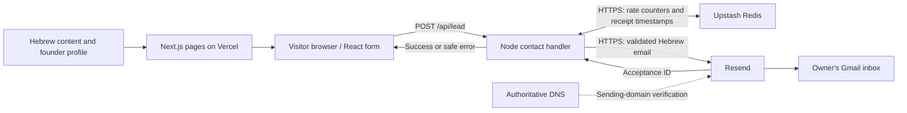

# Posiblo

**Launch status: blocked for legal/accessibility review.** See [the launch audit and owner questions](docs/Legal_Launch_Audit.md). The three Hebrew legal pages remain dated, unindexed drafts. `npm run legal:check` and `npm run verify:release` intentionally fail until real approval is recorded and draft placeholders are resolved. Production Vercel builds are blocked while the approval record remains a draft; local review builds use `npm run build:e2e`. This is not a legal compliance certification. Internal agreement and data-processing templates in `docs/` are not published site routes.

The owner has confirmed **ניר מאיר** and **posiblo.contact@gmail.com** for public identity and general/privacy/accessibility contact. No address or registration number is published. The [retention procedure](docs/Retention_Operations.md) sets a 12-month target for unconverted enquiries and a quarterly manual review; `npm run retention:review -- --input <private-metadata.json>` is offline and dry-run only. `npm run audit:services` performs explicitly requested read-only checks using local credentials and prints allowlisted status fields only; see [account findings and the manual checklist](docs/Service_Configuration_Checklist.md). It never sends email, reads message content, changes settings or writes Redis keys.

Hebrew-first, responsive RTL website with nine public pages and a server-side contact form. The header/footer wordmark is **Posiblo_**.

## Stack and structure

Next.js 16 App Router, React 19, TypeScript 6, Tailwind CSS 4, ordinary CSS and scoped CSS Modules. Heebo is bundled locally with its license. `libphonenumber-js` validates Israeli and international phone numbers locally; it makes no external requests.

| Location | Purpose |
|---|---|
| `src/app/` | Pages, shared layout, metadata and Node API routes |
| `src/components/` | Navigation, footer, reusable content renderer, contact form and video area |
| `src/content/` | Validated Hebrew copy, explicit CTA routes, founder profile and media configuration |
| `src/lib/` | Shared input validation and server-only email, configuration and abuse protection |
| `src/test/`, `e2e/` | Vitest/Testing Library tests and Playwright/axe browser checks |

Pages: `/`, `/solutions`, `/business`, `/individuals`, `/process`, `/about`, `/contact`, `/solutions/business-automation`, `/solutions/systems-integration`. Legal drafts are under `/legal/`. `/testimonials` and `/thanks` redirect; `/admin` returns 404.

## Architecture and services



| Service | Actual role and connection |
|---|---|
| **Vercel** | Owner-configured hosting runs the Next.js website and Node contact endpoints; production variables are configured in its dashboard. |
| **Resend** | The server uses its installed SDK and private API key to send inquiries from a verified sender domain to **posiblo.contact@gmail.com**. |
| **Upstash Redis** | The server calls its HTTPS REST API to share rate limits and stable submission timestamps across instances. |
| **Gmail** | The owner's mailbox receives the emails sent by Resend; the application does not use the Gmail API. |
| **DNS** | Domain redirects and email authentication records are managed externally. Verify Resend records at the authoritative DNS provider; no DNS API integration exists in the application. |
| **GitHub** | The configured Git origin is on GitHub; deployment hooks and CI are not defined in this repository. |

Vercel/DNS account settings live outside this repository. AI/CRM/tool names in website copy describe capabilities; scheduling CTAs open the contact request flow.

**End-to-end contact flow:**

```text
Visitor fills form and checks consent
  → frontend validation → POST /api/lead
  → origin/configuration checks → Redis rate limit → backend validation
  → stable Redis receipt timestamp → Resend → posiblo.contact@gmail.com
  → Resend acceptance ID → API success → Hebrew confirmation in browser
```

The legacy `/api/send-email` route shares the same handler. Name, message, caller type, consent, and at least one contact method are required; both email and phone are supported. The submit button stays gray and disabled without consent. Emails include optional fields and server receipt time in `Asia/Jerusalem`.

The server caps request size, checks a honeypot and completion time, permits five attempts per client per ten minutes, and fails closed on Redis errors. Resend retry keys protect unchanged submissions for 24 hours. Redis stores hashed-IP counters for ten minutes and random inquiry IDs/timestamps for 25 hours; message contents remain in the email delivery path. Application diagnostics exclude contact details and messages. Provider acceptance is distinct from mailbox arrival.

## Local setup and configuration

Use Node **24.22.0** (`.node-version`) and npm **11.19.1**. Run `npm ci`; for first-time setup, copy [.env.example](.env.example) to private `.env.local` only if it does not already exist. Preserve existing private configuration and secrets. Then run `npm run dev`. Open [localhost:3000](http://localhost:3000). In PowerShell, use `npm.cmd` if `npm.ps1` is blocked.

| Variable | Purpose |
|---|---|
| `NEXT_PUBLIC_SITE_URL` | Public HTTPS website origin; canonical production origin is `https://posiblo.com` |
| `SITE_INDEXING_ENABLED` | Defaults to `false`; set `true` only for the approved production release at the canonical origin; previews and development remain noindex |
| `CONTACT_FORM_ENABLED` | Defaults to `false`; set to `true` when sending configuration is ready |
| `RESEND_API_KEY` | Private Resend key with sending access |
| `CONTACT_FROM_EMAIL` | `website@posiblo.com`; its domain must be verified in Resend |
| `UPSTASH_REDIS_REST_URL` | HTTPS `*.upstash.io` REST origin |
| `UPSTASH_REDIS_REST_TOKEN` | Private read/write token |
| `CONTACT_RATE_LIMIT_SECRET` | Private random secret of at least 32 characters, shared across instances |
| `CONTACT_TRUST_PROXY` | Set to `true` only behind an ingress that overwrites `x-forwarded-for` with the client IP |
| `CONTACT_ALLOW_LOCAL_ORIGIN` | Optional local `npm start` only: set `true` to accept the matching `http://localhost:<port>` origin. Ignored when `VERCEL` or `VERCEL_ENV` is set; keep disabled on hosting. Delivery and rate limiting still use the configured providers. |

Production requires the origin, trusted ingress, Redis and Resend settings. Development may use in-memory rate/receipt storage when Redis is absent. Local development accepts the local request origin even when the production URL is configured. The recipient is fixed server-side in `src/lib/contact-config.ts`; `CONTACT_TO_EMAIL` and `LEGAL_REVIEW_APPROVED` are obsolete.

If the live form is disabled, open `/contact` and inspect Vercel runtime logs for `contact_configuration_unavailable`. Its `invalidSettings` list names missing/invalid variables without logging their values. Check the active deployment's settings; saved dashboard edits require a new deployment to take effect.

Set production variables separately in Vercel; `.env.local` is not uploaded. Only the site URL uses a public prefix. API keys, tokens and the security secret must stay server-only and out of Git. Rebuild after changing the site origin or indexing configuration. Use `npm run build` followed by `npm start` for a local production server; use the configured HTTPS origin or an appropriate local HTTPS setup to test its protected submission endpoint.

See [contact setup](docs/Contact_Form_Setup.md) for the free-service comparison and account/DNS steps. An earlier direct Redis/Resend test reached the previous inbox. That historical result does not verify the new sender or business Gmail recipient. Automated tests intercept delivery; production website-form delivery requires a separate live check after deployment.

## Production migration checklist

The primary origin is `https://posiblo.com`. Keep `https://www.posiblo.com`, `https://bottomline-ai.com`, and `https://www.bottomline-ai.com` as permanent Vercel redirects to the same path on the primary origin, preserving query strings. Do not add competing redirect rules or recreate the existing Vercel project/GitHub repository.

The approved business contact and fixed inquiry recipient is **posiblo.contact@gmail.com**, a free personal Gmail account. Automated inquiries are sent through Resend as **website@posiblo.com**, with the visitor's validated email as Reply-To. Google Workspace is cancelled and is not used; no Google Workspace MX records or paid mailbox are required for this setup. Resend sending-domain verification remains a separate external requirement.

Before an authorized deployment:

1. Verify the existing Vercel project's GitHub connection, Production branch, root directory, and automatic promotion settings. Local uncommitted work is not deployed by a GitHub push.
2. Verify Production configuration: `NEXT_PUBLIC_SITE_URL=https://posiblo.com`, `CONTACT_FROM_EMAIL=website@posiblo.com`, `SITE_INDEXING_ENABLED=true` for the approved indexable release, and `CONTACT_FORM_ENABLED=true` only when delivery configuration is ready. Verify the existing private `RESEND_API_KEY`, `UPSTASH_REDIS_REST_URL`, `UPSTASH_REDIS_REST_TOKEN`, `CONTACT_RATE_LIMIT_SECRET` (at least 32 characters), and trusted ingress before setting `CONTACT_TRUST_PROXY=true`. Keep preview/development indexing disabled. No private environment files are changed by these instructions.
3. Verify `posiblo.com` sending authorization in Resend and publish its exact required authentication records at authoritative DNS, preserving unrelated records. Do not assume Google Workspace verification is relevant. No provider verification or live delivery is established by a successful local build.
4. Run the local checks and `npm run verify:release`. That script deliberately clears delivery credentials and disables the form; **its `.next` output is a test artifact and must not be deployed**. Rebuild with approved Production settings for the actual release.
5. Review and commit the intended changes only when authorized, then push/merge to the configured Production branch only when deployment is authorized. Vercel must build the approved revision with the verified Production settings. This migration task does not itself authorize committing, pushing, or deploying.
6. After the authorized deployment, inspect all nine live titles, canonicals, Open Graph URLs, robots and sitemap; verify permanent redirects and query preservation. Conduct a real form-to-Gmail test only with explicit authorization, checking Resend acceptance and actual mailbox receipt separately.
7. Verify ownership of old/new Search Console properties, complete the applicable Change of Address steps for old hostname variants, submit the new sitemap, inspect representative URLs, and monitor indexing. Preserve old-domain redirects for at least a year. Legal pages remain drafts with noindex until separately reviewed and approved.

The earlier post-domain audit is historical evidence. Its proposed Google Workspace mailbox and setup steps were superseded by the confirmed Gmail/Resend configuration above; its live observations are not a current deployment status report.

See the [domain migration implementation report](docs/Posiblo_Domain_Migration_Implementation_Report.md) for the completed changes, verification results, remaining manual actions, and deployment limitations.

## Content and future media

Run `npm run content:generate` after an approved edit to [the authoritative brief](docs/BOTTOMLINE_WEBSITE_BRIEF.md), then review `src/content/pages.json` and run `npm run content:check`. The brief contains **Posiblo** verbatim; regeneration performs no legacy-name substitution. The brief filename is retained for pipeline compatibility. The canonical origin is `https://posiblo.com`. The P favicon is provisional, not approved final artwork. Historical reports remain unchanged. `src/content/about-profile.ts` adds the subsequently supplied founder facts at runtime and replaces the original About placeholders; update that file for profile/photo/LinkedIn changes.

The founder introduction reuses the homepage hero's video area, after the main value proposition in reading order. Its Hebrew introduction, native portrait player and permanent meeting CTA live in `src/components/introduction-video.tsx`, styled in `src/app/globals.css`. The CTA uses the existing `/contact#inquiry` flow.

The displayed video is `public/videos/founder-introduction-blurred.mp4`, with `founder-introduction-poster-blurred.webp` as its poster, configured in `src/content/introduction-video.ts`. The player reserves a 9:16 area, capped at 260px wide, uses `preload="none"` and inline native controls, and does not autoplay or loop. The footage is 720×1280 and 82.32 seconds long. Its burned-in Hebrew subtitles were confirmed by the owner and in sampled frames; there is no separate subtitle stream or configured `<track>`. Full audio/subtitle accuracy and synchronization have not been independently verified. All four files in `public/videos`, including the original MP4 and poster, are intentional and directly addressable; none were changed or removed. A transcript is beneficial but its absence alone is not treated as proof that captioning fails. Important visual information must be assessed against the audio before deciding whether further description is necessary.

The player now uses `founder-introduction-blurred.mp4` and `founder-introduction-poster-blurred.webp`, generated by `node scripts/prepare-founder-video.mjs`. The script applies a Gaussian blur only to the 280×88px watermark patch at x=408, y=1168, with an 8px feathered edge. It encodes H.264 at CRF 18, copies the original audio, preserves the portrait dimensions, and enables MP4 fast start. The blur is part of the media, so native controls, fullscreen and picture-in-picture retain it without browser overlays or runtime processing. The original MP4 and poster remain unchanged. Install FFmpeg locally or set `FFMPEG_PATH` to its executable; the script also detects `.tools/ffmpeg/package/ffmpeg.exe`. FFmpeg is only needed when regenerating assets, not during the website build or on the deployed server. Re-measure the patch if replacement footage moves the watermark.

The founder photo and LinkedIn URL are currently empty placeholders; GitHub is omitted. Legal pages remain clearly marked drafts and need factual completion/review independently of the form switch. Older status reports in `docs/` describe earlier milestones.

## Validation

```sh
npm run content:check
npm run lint
npm run typecheck
npm test
npm run build
```

ESLint checks code quality; TypeScript checks application/tests; Vitest, Testing Library and jsdom test behavior; Playwright and axe verify browser layouts, navigation, forms and accessibility. Vite supports the test tooling.

For browser tests, build the isolated fixture **after** the normal production build:

```sh
npm run build:e2e
npm run test:e2e
```

The fixture build uses a shared fake public origin and overrides production settings in memory, preserving `.env.local`. Tests start local servers on **3100–3101**, use fake service credentials and intercept submissions. Screenshot, trace and video capture are disabled. If installed Chrome is available, PowerShell can run `$env:PLAYWRIGHT_BROWSER_CHANNEL='chrome'` followed by `npm run test:e2e -- --project=desktop --project=tablet --project=mobile --project=contact-chromium --project=contact-mobile`. Firefox/WebKit still require their Playwright binaries. Run `npm run build` again before using the output as a real production build.

Use existing browser installations first. The local `.tools/node-v24.22.0-win-x64` supplies Node 24.22.0/npm 11.19.1, and `.tools/playwright-browsers` contains the browser binaries. Set `PLAYWRIGHT_BROWSERS_PATH` to that absolute directory. The follow-up passed **248 unit tests** and **153 browser tests across Chromium, Firefox and WebKit**, with five skips (four mobile-only cases outside mobile, plus Windows WebKit MP4 playback). Firefox requires an execution environment that permits its normal process sandbox; the website and browser sandbox settings were not weakened. Windows WebKit rejected the MP4 even in isolated HTML; verify media playback on real Safari separately. The existing WebKit fixture removes only `upgrade-insecure-requests` from loopback HTTP document responses; production headers are tested separately. Automated results do not certify accessibility, actual screen-reader output, native browser-UI zoom or live email delivery.

Git ignores private env files, dependencies, builds, test output, caches, private keys and local design exports. `.env.example`, the brief, source files, lockfile and tests are intended to be versioned. CI and automated dependency monitoring are not configured.
