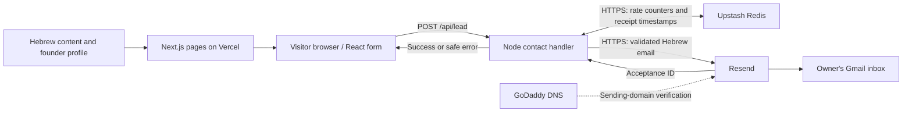

# BottomLine

Hebrew-first, responsive RTL website with seven public pages and a server-side contact form. The header/footer wordmark is **BottomLine_**.

## Stack and structure

Next.js 16 App Router, React 19, TypeScript 6, Tailwind CSS 4, ordinary CSS and scoped CSS Modules. Heebo is bundled locally with its license. `libphonenumber-js` validates Israeli and international phone numbers locally; it makes no external requests.

| Location | Purpose |
|---|---|
| `src/app/` | Pages, shared layout, metadata and Node API routes |
| `src/components/` | Navigation, footer, reusable content renderer, contact form and video area |
| `src/content/` | Validated Hebrew copy, explicit CTA routes, founder profile and media configuration |
| `src/lib/` | Shared input validation and server-only email, configuration and abuse protection |
| `src/test/`, `e2e/` | Vitest/Testing Library tests and Playwright/axe browser checks |

Pages: `/`, `/solutions`, `/business`, `/individuals`, `/process`, `/about`, `/contact`. Legal drafts are under `/legal/`. `/testimonials` and `/thanks` redirect; `/admin` returns 404.

## Architecture and services



| Service | Actual role and connection |
|---|---|
| **Vercel** | Owner-configured hosting runs the Next.js website and Node contact endpoints; production variables are configured in its dashboard. |
| **Resend** | The server uses its installed SDK and private API key to send inquiries from a verified sender domain to **meirnir89@gmail.com**. |
| **Upstash Redis** | The server calls its HTTPS REST API to share rate limits and stable submission timestamps across instances. |
| **Gmail** | The owner's mailbox receives the emails sent by Resend; the application does not use the Gmail API. |
| **GoDaddy** | The owner confirmed using its DNS setup to verify the sending domain in Resend; there is no GoDaddy API integration in the application. |
| **GitHub** | The configured Git origin is on GitHub; deployment hooks and CI are not defined in this repository. |

Vercel/GoDaddy account settings live outside this repository. AI/CRM/tool names in website copy describe capabilities; scheduling CTAs open the contact request flow.

**End-to-end contact flow:**

```text
Visitor fills form and checks consent
  → frontend validation → POST /api/lead
  → origin/configuration checks → Redis rate limit → backend validation
  → stable Redis receipt timestamp → Resend → meirnir89@gmail.com
  → Resend acceptance ID → API success → Hebrew confirmation in browser
```

The legacy `/api/send-email` route shares the same handler. Name, message, caller type, consent, and at least one contact method are required; both email and phone are supported. The submit button stays gray and disabled without consent. Emails include optional fields and server receipt time in `Asia/Jerusalem`.

The server caps request size, checks a honeypot and completion time, permits five attempts per client per ten minutes, and fails closed on Redis errors. Resend retry keys protect unchanged submissions for 24 hours. Redis stores hashed-IP counters for ten minutes and random inquiry IDs/timestamps for 25 hours; message contents remain in the email delivery path. Application diagnostics exclude contact details and messages. Provider acceptance is distinct from mailbox arrival.

## Local setup and configuration

Use Node **24.22.0** (`.node-version`) and npm **11.19.1**. Run `npm ci`, copy [.env.example](.env.example) to private `.env.local`, then run `npm run dev`. Open [localhost:3000](http://localhost:3000). In PowerShell, use `npm.cmd` if `npm.ps1` is blocked.

| Variable | Purpose |
|---|---|
| `NEXT_PUBLIC_SITE_URL` | Public HTTPS website origin; current owner-provided URL is `https://bottomline-ai.vercel.app` |
| `SITE_INDEXING_ENABLED` | Defaults to `false`; controls indexing, with Vercel previews kept noindex |
| `CONTACT_FORM_ENABLED` | Defaults to `false`; set to `true` when sending configuration is ready |
| `RESEND_API_KEY` | Private Resend key with sending access |
| `CONTACT_FROM_EMAIL` | Email address on the verified Resend sending domain |
| `UPSTASH_REDIS_REST_URL` | HTTPS `*.upstash.io` REST origin |
| `UPSTASH_REDIS_REST_TOKEN` | Private read/write token |
| `CONTACT_RATE_LIMIT_SECRET` | Private random secret of at least 32 characters, shared across instances |
| `CONTACT_TRUST_PROXY` | Set to `true` only behind an ingress that overwrites `x-forwarded-for` with the client IP |

Production requires the origin, trusted ingress, Redis and Resend settings. Development may use in-memory rate/receipt storage when Redis is absent. Local development accepts the local request origin even when the production URL is configured. The recipient is fixed server-side in `src/lib/contact-config.ts`; `CONTACT_TO_EMAIL` and `LEGAL_REVIEW_APPROVED` are obsolete.

Set production variables separately in Vercel; `.env.local` is not uploaded. Only the site URL uses a public prefix. API keys, tokens and the security secret must stay server-only and out of Git. Rebuild after changing the site origin or indexing configuration. Use `npm run build` followed by `npm start` for a local production server; use the configured HTTPS origin or an appropriate local HTTPS setup to test its protected submission endpoint.

See [contact setup](docs/Contact_Form_Setup.md) for the free-service comparison and account/DNS steps. A direct live Redis/Resend test passed and the owner confirmed the Hebrew test email reached Gmail. Automated tests intercept delivery; production website-form delivery requires a separate live check after deployment.

## Content and future media

Run `npm run content:generate` after an approved edit to [the authoritative brief](docs/BOTTOMLINE_WEBSITE_BRIEF.md), then review `src/content/pages.json` and run `npm run content:check`. The generator applies the approved **BottomLine** casing. `src/content/about-profile.ts` adds the subsequently supplied founder facts at runtime and replaces the original About placeholders; update that file for profile/photo/LinkedIn changes.

The hero video is configured in `src/content/introduction-video.ts`; it currently reserves a responsive 16:9 area without fake playback. Add real footage and caption tracks there. The founder photo and LinkedIn URL are currently empty placeholders; GitHub is omitted. Legal pages remain clearly marked drafts and need factual completion/review independently of the form switch. Older status reports in `docs/` describe earlier milestones.

## Validation

```sh
npm run content:check
npm run lint
npm run typecheck
npm test
npm run build
```

ESLint checks code quality; TypeScript checks application/tests; Vitest, Testing Library and jsdom test behavior; Playwright and axe verify browser layouts, navigation, forms and accessibility. Vite supports the test tooling.

For browser tests, build the isolated fixture **after** the normal production build:

```sh
npm run build:e2e
npx playwright install chromium firefox webkit
npm run test:e2e
```

The fixture build uses a shared fake public origin and overrides production settings in memory, preserving `.env.local`. Tests start local servers on **3100–3101**, use fake service credentials and intercept submissions. Screenshot, trace and video capture are disabled. If installed Chrome is available, PowerShell can run `$env:PLAYWRIGHT_BROWSER_CHANNEL='chrome'` followed by `npm run test:e2e -- --project=desktop --project=tablet --project=mobile --project=contact-chromium --project=contact-mobile`. Firefox/WebKit still require their Playwright binaries. Run `npm run build` again before using the output as a real production build.

Git ignores private env files, dependencies, builds, test output, caches, private keys and local design exports. `.env.example`, the brief, source files, lockfile and tests are intended to be versioned. CI and automated dependency monitoring are not configured.
