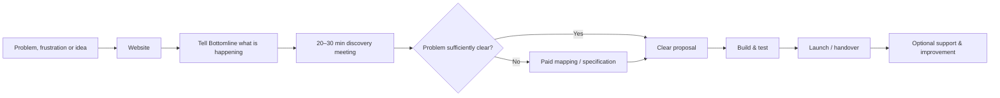

You are Codex, acting as the lead senior full-stack engineer, product designer, UX writer, and technical SEO implementer for the existing Bottomline website.

MISSION
Transform the CURRENT website in this repository into the problem-first, Hebrew-first Bottomline site specified in the research document appended below. This is an IMPLEMENTATION task, not a request for advice, a proposal, or a design-only mockup. Inspect the repository, implement changes in code, run appropriate checks, and report exactly what you changed and what still requires real-world verification.

SOURCE OF TRUTH AND SCOPE
1. Read the entire appended research report BEFORE editing. Pay particular attention to Part J, "Complete publication-ready Hebrew website copy"; Parts D–I, which explain strategic rationale, funnel, architecture, pricing and trust; and Parts K–L, which list legal boundaries and rollout priorities.
2. Treat Part J as the authoritative copy deck. Preserve its FINAL Hebrew headings, paragraphs, bullets, CTAs, FAQs, field names, placeholders, success message, navigation, footer, SEO meta titles, and descriptions. Do not replace them with generic AI-marketing copy, abbreviate them, or omit entire sections. The source's examples and internal strategic notes should NOT automatically become customer-visible text.
3. If a copy detail conflicts with the current implementation, change the implementation to match Part J, unless the text asserts an unverified operational promise, a legally sensitive claim, or a feature that does not actually exist; in those cases implement the honest safe alternative, leave a clearly tracked TODO, and report the discrepancy. Never fabricate evidence or operational capabilities.
4. This project may already have useful code, content, images, integrations and styling. Audit first; reuse and refine as much as possible. Do not rebuild from scratch without a specific technical reason. Keep the existing framework, routing and design conventions unless a change is necessary. Do not delete unrelated features, assets, config, or user data.
5. Use the temporary brand label "Bottomline" in public-facing copy as the report does, but mark trademark/name clearance as a launch blocker in a human-readable release checklist. Do NOT claim clearance or attempt to resolve legal clearance in code.

DESIRED EXPERIENCE
- Primary audience: Israeli B2B owners, self-employed operators and SMBs; equally welcome: individuals and entrepreneurs with significant digital problems/ideas. Do not imply consumer device repair or universal IT support.
- Lead with the visitor's pain/problem, THEN show solution families/technology: automation, AI, custom systems/software, websites, apps, MVPs, APIs/integrations, CRM/leads, reports/data where relevant.
- Tone: natural, credible, plain-spoken professional Hebrew, not hype. No unsupported percentages, client counts, experience years, logos, testimonials, case studies, or promised ROI.
- Main conversion: a genuine introductory/discovery meeting, not an "AI consultation" sales funnel.
- The real operating model is personal direct ownership, with possible specialist collaborators when necessary; do not falsely present a permanent agency-sized team.
- Explicitly convey "not every problem needs AI or custom development."

REPOSITORY AUDIT — DO FIRST
- Identify package manager, framework, app/page structure, current routes, layout, localization, design system, forms, backend/endpoints, scheduling, contact methods, analytics, SEO and legal pages, tests, build scripts and deployment assumptions.
- Find all occurrences of obsolete/inconsistent branding: "Sogomatic", "אוטומציה חכמה", legacy domains/emails/phone numbers, branding in document titles, favicons, social previews, metadata, redirects, URLs, form autoresponders, components and assets. Remove or normalize outdated customer-facing names after checking whether they are still technically necessary. Do not invent contact information or break existing domain routing.
- Inventory risky statements (e.g., 50+ customers, 5 years, 50%/90% savings, unverifiable testimonials). Remove/hide unless the repository includes verifiable support and publication permission; document exceptions.
- Audit contact route, current integrations, deployed behavior assumptions, legal pages and mobile usability. Make a short executable change plan internally, then implement it without requesting permission for ordinary repository edits.

INFORMATION ARCHITECTURE AND COPY IMPLEMENTATION
Implement these seven Hebrew routes using the repository's conventions. Preserve existing compatible slugs when doing so avoids breaking public links; otherwise add appropriate routes and redirects. Use semantic HTML landmarks, one H1 per page, accessible headings, meaningful internal links and distinct metadata per route.
1. Home / דף הבית: every Part J home section in order: hero eyebrow/headline/body and two CTAs, meeting reassurance, "נשמע מוכר?" five problem cards, "אז מה Bottomline עושה?" six capabilities, two audience pathways, five-stage process, "לא כל דבר צריך AI", all six FAQs, and closing CTA. Avoid duplicate filler or unsupported trust metrics.
2. Solutions / פתרונות: exact lead and all six problem/solution sections, capability toolbox and meeting CTA.
3. Business / לעסקים: the B2B headline and intro, symptoms, improvable processes, "לא מחליפים מערכת רק כי אפשר", first-contact explanation and CTA.
4. Individuals & entrepreneurs / לפרטיים וליזמים: all four use cases, "לא כל רעיון צריך אפליקציה", CTA.
5. How we work / איך עובדים יחד: intro, first-meeting scope, what visitors need NOT prepare, both post-meeting routes, project delivery/handover, CTA. Show 20–30 minute free introductory meeting only if operationally accepted; this is NOT a promise to deliver full unpaid specification.
6. About / אודות: copy as in report, personal single-operator voice and clearly delineated collaborators. DO NOT publish placeholder text such as "[שם מלא — נדרש להשלמה]"; where verified owner identity/background/photo are not available in the repo, safely omit or show a neutral alternative, and record exact missing facts for the owner. Do not invent photo, years of experience, customer list, or portfolio.
7. Contact / בואו נכיר: actual working contact UX, not an empty shell. All report field labels, helper placeholders and meeting preference choices. Required: name, a usable reply contact (phone OR email), caller type, free-text problem description and privacy acknowledgement. Optional: existing systems/tools, indicative budget, meeting format. Use explicit choice of אונליין / פנים אל פנים / אין העדפה. Include the exact source-derived privacy acknowledgement, button and success text, with genuine backend confirmation only after successful submission.
Navigation in this exact conceptual order: דף הבית | פתרונות | לעסקים | לפרטיים וליזמים | איך עובדים יחד | אודות | בואו נכיר. Main header button: "לקביעת פגישת היכרות". Use footer structure/copy and legal links from Part J. If a booking service is currently integrated, point meeting CTAs to a verified working booking flow. Otherwise route them to the functioning contact page; do NOT invent a Calendly URL or imply a confirmed booking. Consider adding distinct CTAs that retain visitor intent (business/idea/problem) without forcing a technology choice.

CONTACT FLOW, SECURITY AND PRIVACY
- Verify the form actually persists/delivers inquiries via the existing configured channel. If no real backend exists, implement a secure and supportable submission path if supported by the repo/environment; never fake success. If secrets or vendor setup are missing, make it explicit in the README/checklist and leave the UI honest about unavailable submission rather than silently dropping leads.
- Validate client AND server; enforce sane input lengths, no exposed secrets, anti-spam measures proportionate to the stack, rate limiting where feasible, safe error handling, clean accessible validation, loading/disabled state and success/error messages; never log personal information unnecessarily.
- The form must support phone OR email as the required contact method, rather than incorrectly requiring both. Implement understandable labels, format validation, and sensible user privacy protection.
- Privacy checkbox must refer to the actual current privacy policy. Marketing/newsletter consent, if offered at all, must be separate, unchecked and optional. Do not send marketing by default.
- Do not promise specific response SLAs, customer outcomes or meeting availability unless actually supported.
- Track qualified inquiry and booking-related events only if consent/configuration and the site's actual analytics setup support it. Do not embed fake tracking IDs or violate privacy choices.

DESIGN, UX, ACCESSIBILITY
- Fully Hebrew-first with correct dir="rtl" and lang="he" semantics; explicitly isolate embedded English brand/technology strings, emails, code-like tokens and numbers when needed to avoid bidi glitches.
- Strong typography/hierarchy, calm professional visual design, polished mobile-first responsive layouts; maintain brand coherence across header/footer/forms/cards/FAQ, ample spacing, appropriate visual contrast, meaningful focus indicators.
- Keyboard usable menus, forms and FAQ; proper labels, error messages, semantic roles, heading order, alt text, reduced motion and responsive tap targets. Do not mistake an accessibility overlay for actual accessibility.
- All CTAs must work and lead to a sensible destination. No decorative fake buttons or dead links. Provide sensible not-found behavior, no console errors, no horizontal overflow.
- Keep the visual system maintainable and consistent with the current stack; avoid introducing unnecessary libraries or distracting motion.

TECHNICAL SEO AND PERFORMANCE
- Implement EXACT per-page meta title and description from Part J; canonical URLs based on the actual configured production domain only; no made-up domain. Use appropriate robots directives for environments, correct language, Open Graph/social cards when assets exist, sitemap/robots if supported by current architecture, and clean indexed links.
- Add structured data only if it matches verified real-world facts (e.g. avoid invented address, ratings, review counts, staff, opening hours). Use FAQ structured data only if technically appropriate and content matches visible FAQs.
- Prioritize fast mobile performance, minimized JS, optimized images/fonts, stable layout and sensible caching. Don't undermine functionality for synthetic performance targets.
- Preserve SEO value with redirects for changed known routes; verify no broken internal links, duplicate title tags or invented claims.

LEGAL AND BRAND SAFETY
- The source notes that old policy/terms were dated Dec 2024, contain legacy branding/contact info and may not reflect Israeli privacy law Amendment 13 (effective Aug 14, 2025), accessibility duties, B2C obligations and anti-spam requirements. Audit them thoroughly; fix demonstrably stale technical/branding details and factual descriptions, but DON'T fabricate a legally compliant policy or make unverified legal claims. Flag final review by qualified Israeli legal/accessibility professionals as a release dependency.
- Verify whether the actual site collects analytics cookies, contact information, third-party API data, hosting/logging, AI content or scheduling information before describing these practices in the policy.
- Link only to real, existent privacy, terms and accessibility pages; for missing required documents create transparent review-required drafts or placeholders that explicitly remain unpublished/release blockers rather than falsely finalized policies.
- Preserve customer privacy and accessibility practices in the actual code.
- Trademark/name clearance for Bottomline and ownership/domain strategy require human review before major public launch. Do NOT buy/register anything.

IMPLEMENTATION QUALITY, TESTS, AND DEFINITION OF DONE
- Make real file changes. Add/refine reusable UI components only where beneficial, using types and patterns consistent with the repo.
- Run install (only if appropriate and safe), lint, typecheck, tests and production build where available. Resolve errors caused by the changes; clearly report pre-existing failures. Add pragmatic coverage of route rendering, navigation, form validation, success/failure behavior and accessibility-relevant interactions where tests exist.
- Confirm each of the seven pages renders all required research-copy sections and has working internal navigation and appropriate SEO metadata. Verify old claim/brand strings are absent from public-facing content except where explicitly preserved for technical redirects.
- Produce a concise final report: files/routes changed, functionality verified, command results, any deviations from verbatim Part J and why, and a clear launch-blockers checklist (trademark, identity, real contact destinations, legal review, privacy text, documented testimonials, production environment/secrets, working form delivery).
- Do NOT stop after producing a plan or asking me to choose a visual design. Make best-effort changes now with reasonable engineering defaults. Don't push, deploy, buy services, delete data or make irreversible external changes without explicit instruction.

IMPORTANT ORDER OF PRECEDENCE
(1) Truth, actual verified functionality, safety, privacy, legal limitations; (2) Part J final Hebrew copy; (3) remaining appended research strategy and recommendations; (4) existing design conventions, provided they support the new positioning. If research material is uncertain, distinguish recommendation from verifiable fact.

================ BEGIN COMPLETE RESEARCH REFERENCE ================
# Bottomline Israel: Market Strategy, Positioning, and Publication-Ready Website Copy

## Executive summary and market opportunity

**Part A — Executive summary**

Bottomline should **not** position itself primarily as an AI company, an automation agency, a web-development studio, or an app-development company.

The strongest position is:

> **A technology problem-solving studio that first understands what is slowing the customer down, then chooses or builds the right solution.**

The central commercial idea is therefore **problem first, technology second**. The customer should not be expected to arrive knowing whether they need AI, an automation, an app, an integration, a website, or custom software. Bottomline's job is to discover that.

This fits the Israeli small-business market particularly well. The Small and Medium Business Agency identifies finding customers, production costs, and labor availability among the persistent barriers facing SMEs, while 61.5% of Israeli businesses operate without employees, making owner time and operational capacity especially scarce. citeturn16search0turn24search0

AI should remain highly visible as a **capability**, but not become the brand promise. In the SBA's 2025 research, 28% of Israeli businesses reported integrating AI into business activity, yet among non-users roughly half said they did not sufficiently understand how AI tools could help them. Among businesses already using AI, the most frequently reported benefit was time saving. That combination strongly supports explaining outcomes before technologies. citeturn24search9turn17view0

The existing website already contains the seed of the right positioning: it asks visitors to describe repetitive or time-consuming tasks and begins its process with diagnosis and characterization. Those elements should stay. But the website currently narrows the business almost entirely to automation/AI, makes prominent quantitative claims such as "up to 50%" and "up to 90%" time savings, presents customer testimonials and business-volume claims that cannot be independently verified from the reviewed material, and uses three different brand identities: the page title says Sogomatic, the site/footer says "אוטומציה חכמה", while the URL says Bottomline. citeturn15view0turn15view1turn15view2

There is also a **significant brand-risk issue that should be resolved before investing heavily in Bottomline as a name**. A longstanding international software/financial-technology company already operates as Bottomline, reports serving more than one million institutions and businesses, and has an office in Or Yehuda, Israel. This does not by itself establish a trademark infringement, but it creates a real SEO, discoverability, and potential legal-confusion risk. A professional trademark/name clearance is warranted. citeturn23search0turn23search1

### Recommended business model at a glance

| Area | Recommendation |
|---|---|
| Position | Independent technology problem-solving studio |
| Primary promise | Understand the problem → design the right solution → build it |
| Market | B2B and B2C both supported |
| Business priority | Israeli self-employed, micro, small and medium businesses |
| B2C definition | Individuals, entrepreneurs and people with a meaningful digital problem or product idea |
| Technology | Automation, AI, software, apps, websites, integrations and APIs |
| AI | Capability, not the master brand |
| Sales mechanism | Discovery meeting as the central conversion event |
| First meeting | Free 20–30 minute fit/discovery meeting |
| Complex projects | Paid diagnosis/specification phase before development |
| Pricing | Fixed-price milestones where scope is clear; capped T&M where uncertain; optional support retainer |
| Delivery | Direct work with you; specialists added when the project genuinely needs them |
| Trust strategy | Personal accountability, transparent process, real evidence—not inflated statistics |
| Website structure | Problem-led at the top, capability-led underneath |
| Brand | **Clear the Bottomline name before major investment** |

The overarching customer journey should be:

**The strategic change is subtle but fundamental:** today the site effectively says *"We do automation and AI—tell us which task to automate."* The new Bottomline should say *"Tell me what is getting in your way. We'll decide together what, if anything, should be built."*

**Part B — Market opportunities and customer needs**

### What the Israeli evidence says

The Israeli SMB market is large and heavily weighted toward very small operators. The SBA's April 2026 analysis examined about 625,000 businesses as of the end of 2025 and found that 61.5% operated without employees. citeturn24search0

This matters because Bottomline is not only selling "digital transformation." For a solo professional or five-person business, removing a recurring administrative bottleneck can effectively create additional operating capacity without adding another employee. That is a **strategic inference**, not a measured ROI claim.

Recent official research also points to a market under significant cost and operational pressure. The SBA's 2019–2024 series identifies customer acquisition, production costs and workforce availability as recurring SME barriers; in 2024 one in four surveyed business owners considered closing their business. citeturn16search0turn24search7

Cash flow remains relevant as well. Bank of Israel reported that demand for credit by micro and small businesses continued rising in the fourth quarter of 2025 and associated part of that increase with refinancing, inventory and working-capital needs. In the first quarter of 2026, overall business credit demand rose, while some tightening was reported for higher-risk small-business credit. citeturn16search5turn16search13

That means Bottomline's marketing should not sound like:

> "Adopt the future of AI."

It should sound like:

> **"Where are you losing time, money, leads or control today?"**

### AI is an opportunity—but the sales story needs to be simpler

The SBA's 2025 AI study found that 28% of Israeli businesses were already using AI as part of their operations; usage was 31% among self-employed respondents, 26% among micro businesses, 18% among small businesses and 32% among medium businesses. Around two-thirds of AI-using businesses paid for AI tools. citeturn24search9

Among AI users, reported benefits included time savings, product improvement and lower dependence on external resources. Writing/text and graphics were much more common use cases among smaller firms than sophisticated automation, bots or data work. citeturn17view0turn17view1

CBS research similarly found substantial AI activity in marketing/sales and business-management processes; 42% of businesses using AI reported making no dedicated organizational changes for adoption, while common changes among the others included creating new work processes and training or recruiting people with AI knowledge. citeturn17view2turn17view3

The marketing implication is important:

**Do not sell AI literacy. Sell business improvement.**

A business owner who says:

> "Every lead comes from somewhere else and I keep forgetting who I called"

should not first be shown:

> "AI agents + n8n + WhatsApp API + vector database."

They should hear:

> "Let's map what happens from the moment a lead enters until they become a customer."

### Recommended B2B opportunity areas

For B2B, the highest-fit initial segments are not defined by industry alone. They are businesses with **process pain**:

| Observable problem | Potential solution family |
|---|---|
| Repeated copying between systems | Automation / integrations |
| Leads disappearing or slow follow-up | CRM workflow / automation |
| Owner constantly answering the same questions | Process redesign / self-service / AI |
| Repetitive document processing | Custom software / automation / AI |
| Existing tools do not communicate | APIs / integrations |
| Excel/Sheets has become an internal "system" | Internal application |
| Existing website creates work instead of reducing it | Website/process redesign |
| A workflow only exists in someone's head | Process mapping + custom system |
| Need a new digital product | MVP / web or mobile application |
| Existing SaaS almost works but not quite | Integration / extension / custom layer |

These are recommendations, not claims that every business with these symptoms requires software.

### B2C should be broad enough to matter—but narrow enough to stay credible

There is insufficient public evidence to responsibly claim a specific Israeli market size for consumer purchases of bespoke software development. Therefore, the B2C strategy should initially be treated as a **market hypothesis to validate**, not a proven demand pool.

The strongest B2C opportunities are likely to be:

**Individuals with a serious technology need**, not generic consumer tech support.

Examples include a person with an app idea, an entrepreneur validating a side project, someone who needs a purpose-built personal tool, a professional purchasing the solution personally rather than through a company, or someone with a recurring process that existing products do not solve.

Bottomline should **not** become:

> "Anything technology-related for anyone."

That sounds limitless and reduces credibility.

It should become:

> **"If a software or digital solution can meaningfully solve the problem, let's explore it."**

That preserves the broad capability without implying laptop repair, consumer electronics support, cybersecurity incident response, IT help desk work, or every other category of technology service.

### Israeli customer psychology: practical interpretation

I did not find a robust current Israeli primary-source dataset that directly measures how SMB buyers select small custom-software/automation suppliers. The following therefore combines the official market evidence with observed competitor positioning and should be treated as a strategic inference.

Israeli SMB customers are likely to be especially sensitive to four questions:

**"Will this actually solve my problem?"**  
Cost and cash-flow pressure make vague innovation projects harder to justify. citeturn16search0turn16search5

**"Do I understand what I am buying?"**  
Nearly half of AI non-users in the SBA study reported not understanding sufficiently how available tools could help them, making jargon-heavy selling particularly counterproductive. citeturn17view0

**"Who am I actually working with?"**  
Several smaller competitors deliberately make direct founder/expert contact part of their offer; SFB, for example, explicitly promotes dealing directly with its operator rather than a sales team, while Unit 01 emphasizes that the people on the scoping call also build the product. citeturn18search0turn21search3

**"How much is this going to turn into?"**  
Competitors increasingly clarify project versus tool versus maintenance costs, and some publish fixed-price or starting-price structures. citeturn18search0turn18search3turn21search3

This is why Bottomline's strongest sales style should be **consultative, transparent and technically confident without being technology-first**.

## Competitive landscape and recommended positioning

**Part C — Competitor analysis**

The Israeli market is already crowded with providers describing themselves through AI, automation, software development, CRM, apps or digital transformation. The opportunity is therefore not to claim that Bottomline can also build those things; competitors already do. The differentiation must be in **how Bottomline decides what should be built and how personally the customer is guided through that decision**. citeturn18search2turn19search0turn19search2turn21search8

### Israeli/Israel-focused competitor comparison

| Provider | Main positioning observed | What they do well | Strategic implication for Bottomline |
|---|---|---|---|
| **SFB** | AI/automation tied to business outcomes | Direct expert contact, process-first explanations, transparent separation of build/tool/maintenance cost | Personal contact alone is not unique; Bottomline must broaden beyond automation and make discovery deeper. citeturn18search0turn18search3 |
| **STSICONIC** | AI, automation and custom software | Broad technical scope; consultative selling around business challenges | Direct overlap with broad Bottomline capabilities means a generic "AI + software" pitch will not differentiate. citeturn18search4turn18search7 |
| **UIDB** | Boutique R&D/software + AI/automation | Strong technical authority, SaaS, CRM, DevOps and custom software | Bottomline should compete on accessibility, personal ownership and SMB problem discovery—not enterprise breadth. citeturn18search2turn18search8 |
| **SLAtech** | Production-grade AI/software | Technical depth, RAG, architecture, AI opportunity assessment | Shows that technical AI expertise is becoming commoditized as positioning; Bottomline should lead with diagnosis. citeturn19search0 |
| **Smartup / Automation School** | Automation + AI for businesses | Strong educational marketing, concrete processes, business-language messaging | Bottomline needs useful educational content but should avoid becoming perceived only as an automation specialist. citeturn19search1turn19search2 |
| **Dogma** | Apps and complex digital products | App-development authority plus AI, automation and integrations | Good benchmark for customers who already know they need an app; Bottomline can own the stage *before* that conclusion. citeturn21search1turn21search9 |
| **Globalbit** | Israeli software company, apps/web/AI | Strong portfolio/development-company positioning and published SMB offering | Bottomline should not imitate agency scale; it should emphasize direct accountability and right-sized solutions. citeturn21search2turn21search30 |
| **Unit 01** | Boutique product studio | Free scoping call, fixed-price proposals, MVPs/apps/SaaS/AI/automation | Very close structural competitor; Bottomline must make business-process diagnosis, not just product scoping, its signature. citeturn21search3 |
| **Entrypoint** | Broad AI and software solutions | AI agents, voice, MVPs, no-code, custom/complex systems | Demonstrates how quickly a capability catalogue becomes very broad; reinforces the case for problem-led navigation. citeturn21search8 |
| **AllBeeWeb** | AI automation for Israeli businesses | Personal/specialist positioning around existing tools and repetitive work | Direct competition at the small-provider end; reinforces need for broader custom-development story. citeturn21search12 |

### Competitive white space

There is no claim here that Bottomline is the only provider that begins with a problem—some competitors explicitly say they do so. SFB, for example, publishes process-led automation guidance, and STSICONIC describes consultative discovery. citeturn18search9turn18search7

The opportunity is to make this principle **the entire brand architecture**, not one sentence inside an automation service.

That means:

> **Bottomline is not the place you go when you know you need an automation. It is the place you go when you know something is not working well enough and want someone technical to help figure out what should change.**

That is broader, more human and more aligned with the user's intended business model.

**Part D — Recommended positioning and messaging**

### Recommended category

**English internal strategy description**

> Independent technology problem-solving studio for Israeli businesses and individuals.

Possible Hebrew customer-facing category:

> **פתרונות טכנולוגיים לבעיות אמיתיות**

or:

> **סטודיו טכנולוגי לפתרון בעיות ובניית פתרונות מותאמים**

The first is clearer and less pretentious.

### Positioning pillars

**Problem before product.**  
Do not force customers to diagnose themselves.

**Understand before building.**  
The meeting is not a sales ritual; it is part of the solution.

**Technology-agnostic.**  
AI when AI makes sense. Automation when automation makes sense. Custom development when existing software cannot do the job. Sometimes the best recommendation may be not to build something new.

**Personal ownership.**  
The customer works directly with the person understanding and building the solution.

**Expandable expertise.**  
When a project requires additional expertise or capacity, bring collaborators in transparently rather than pretending there is already a large permanent team.

### Core customer-facing marketing copy

**One-sentence proposition**

> **Bottomline פותרת בעיות שגוזלות לעסקים ולאנשים זמן, כסף ואנרגיה — בעזרת הפתרון הטכנולוגי שבאמת מתאים, מאוטומציה ו-AI ועד אתר, אפליקציה, אינטגרציה או מערכת בהתאמה אישית.**

**Elevator pitch**

> **ב-Bottomline לא מתחילים מהטכנולוגיה. מתחילים בשיחה. מבינים איך הדברים עובדים היום, איפה נתקעים, מה עולה לכם בזמן או בכסף ומה הייתם רוצים שיקרה במקום. רק אחר כך בוחרים את הדרך הנכונה — אוטומציה, AI, אתר, אפליקציה, אינטגרציה, מערכת מותאמת או פתרון פשוט יותר. המטרה היא לא להוסיף עוד כלי. המטרה היא לפתור את הבעיה.**

### Three recommended headline directions

**Primary recommendation**

> **לא צריך לדעת איזו טכנולוגיה אתם צריכים.  
> צריך לדעת מה מפריע לכם להתקדם.**

Subhead:

> **נפגשים, מבינים את הסיפור ואת התהליך, מזהים את הבעיה — ואז בונים את הפתרון שמתאים באמת. אוטומציה, AI, אתר, אפליקציה, מערכת, אינטגרציה או משהו אחר לגמרי.**

CTA:

> **בואו נדבר על הבעיה**

Alternative:

> **יש משהו שלוקח יותר מדי זמן, כסף או אנרגיה? בואו נפתור אותו.**

Alternative:

> **הבעיה קודם. הטכנולוגיה אחר כך.**

### CTA system

Use one consistent primary CTA throughout the site:

> **לקביעת פגישת היכרות**

Secondary CTAs:

> **ספרו לי מה מעכב אתכם**  
> **בואו נדבר על הרעיון**  
> **שלחו לי את הבעיה בוואטסאפ**

Avoid making **"ייעוץ חינם"** the main phrase. It frames the interaction as a giveaway and potentially as a sales consultation. You want customers to understand that the purpose is mutual understanding and diagnosis.

### Critical brand warning

The name **Bottomline should be treated as provisional until cleared**. The international Bottomline operates in software/business technology, has a presence in Israel and uses the name extensively worldwide. There is also an unrelated Israeli business consulting site operating under a similar "Bottom Line" name. citeturn23search0turn23search1turn23search9

This is not a determination that the name cannot legally be used. It is a recommendation to perform Israeli trademark, company-name, domain and search-confusion checks before building substantial brand equity.

## Service architecture, discovery, pricing and trust

**Part E — Service architecture**

### Technology-led vs problem-led vs hybrid

| Architecture | Advantage | Weakness | Verdict |
|---|---|---|---|
| Technology-led: AI / apps / automation / websites | Easy to understand and SEO-friendly | Forces customers to self-diagnose; commoditizes Bottomline | Do not use as primary architecture |
| Problem-led: save time / connect systems / build missing tool | Customer-centric and differentiated | Can become vague; harder for service-specific searches | Strong brand architecture |
| **Hybrid** | Problem-led discovery plus explicit technical capability | Requires good hierarchy | **Recommended** |

The homepage should therefore begin with problems and outcomes.

The service/capability layer should exist underneath for customers who already know what they need and for SEO.

### Recommended solution architecture

**Problems Bottomline solves**

> **להפסיק עבודה ידנית שחוזרת על עצמה**  
> **לחבר מערכות שלא מדברות אחת עם השנייה**  
> **לעשות סדר בתהליך מסורבל או איטי**  
> **לבנות כלי שחסר לעסק או לחיים**  
> **להפוך רעיון למוצר עובד**  
> **לשפר אתר או מערכת שלא עושים את העבודה**

Underneath, show the toolbox:

> אוטומציות  
> AI וסוכנים חכמים  
> מערכות ותוכנה בהתאמה אישית  
> אפליקציות ו-MVP  
> אתרים וכלים דיגיטליים  
> APIs ואינטגרציות  
> CRM ותהליכי לידים  
> פתרונות נתונים ודוחות

The message beside that list should be:

> **לא צריך לבחור מכאן. בשביל זה נפגשים.**

That line is important.

**Part F — Discovery meeting design**

The discovery meeting should become one of Bottomline's strongest brand assets.

Name it:

> **פגישת היכרות ומיפוי**

rather than:

> "שיחת מכירה" / "שיחת ייעוץ" / "דמו".

### Recommended first meeting

**Format:** 20–30 minutes, free, virtual by default with an in-person option by arrangement.

The purpose is **fit and understanding**, not detailed unpaid specification.

| Time | Topic | Core question |
|---|---|---|
| First 5 min | Context/story | "ספרו לי קצת על העסק / הרעיון ומה קורה היום." |
| 5–12 min | Current process | "מה קורה מרגע ש-X קורה ועד שהתהליך מסתיים?" |
| 12–18 min | Pain | "איפה זה נתקע? מה חוזר על עצמו? מה הכי מתסכל?" |
| 18–22 min | Impact | "מה הבעיה עולה בזמן, טעויות, כסף, לקוחות או עומס?" |
| 22–26 min | Desired future state | "אם הבעיה נפתרת, איך הייתם רוצים שהתהליך ייראה?" |
| Final minutes | Next step | Summarize what you heard and recommend either no action, a proposal, or deeper mapping |

A key sales discipline should be:

> **Do not present technology until you can repeat the customer's problem back to them accurately.**

That is not only a sales technique. It embodies the brand.

### Questions Bottomline should learn to ask

Not all must appear on a form. They belong in conversation:

**Story:**  
"מה העסק עושה?"  
"מי האנשים שמעורבים בתהליך?"  
"איך הגעתם למצב הנוכחי?"

**Current reality:**  
"מה קורה היום בפועל?"  
"באילו מערכות משתמשים?"  
"מה עדיין נעשה ידנית?"

**Pain:**  
"מה הכי מעכב?"  
"מה קורה כשהתהליך נכשל?"  
"איפה נופלים דברים בין הכיסאות?"

**Value:**  
"כמה פעמים זה קורה?"  
"כמה זמן זה לוקח?"  
"האם זה גורם לאובדן לקוחות, הכנסות, זמן או שליטה?"

**Constraints:**  
"מה אסור לשבור?"  
"איזה מידע רגיש מעורב?"  
"אילו כלים חייבים להישאר?"  
"יש תקציב או דדליין שחשוב לדעת?"

### What happens after the call

For a straightforward project:

> Discovery → written scope → fixed proposal → build.

For something ambiguous:

> Discovery → **paid mapping/specification phase** → solution architecture → proposal → build.

That distinction protects a solo operator from giving days of free analysis and simultaneously gives customers a useful professional deliverable.

The paid diagnostic can include:

> current-state process map  
> desired outcome  
> system/integration inventory  
> options considered  
> recommended architecture  
> major risks and unknowns  
> scope boundaries  
> estimated implementation stages

I recommend crediting some or all of the diagnostic fee toward the project when commercially sensible. That is a pricing recommendation, not a market requirement.

**Part G — Pricing, delivery and trust**

### Recommended pricing model

Israeli competitors demonstrate multiple structures rather than one clear market standard. SFB describes a fixed implementation quote after diagnosis, with tool costs and optional monthly monitoring separated; Unit 01 advertises a free 30-minute scoping call and fixed-price proposal; Globalbit publishes fixed-pricing positioning for its small-business service and a project starting point. These are provider-specific commercial models, not representative market averages. citeturn18search0turn18search3turn21search3turn21search30

For Bottomline, use:

| Situation | Recommended model |
|---|---|
| First fit meeting | Free |
| Clearly scoped small project | Fixed project price |
| Larger app/system | Fixed-price milestones |
| Ambiguous problem | Paid discovery/specification first |
| Experimental R&D | Time & materials with a defined cap/checkpoint |
| Continuous monitoring/support | Optional monthly retainer |
| Third-party SaaS/API/hosting | Separately itemized |

Do **not** make hourly pricing the public value proposition.

An hourly rate encourages the customer to evaluate:

> "How many hours will this take?"

You want them evaluating:

> "Is the result worth the investment?"

Internally, however, every fixed quote should still be modeled from expected time, risk, external costs and partner costs.

### Public pricing language

Recommended website copy:

> **כמה זה עולה?**  
> אין מחיר אחד לפתרון טכנולוגי, כי אין שתי בעיות זהות. אחרי שנבין מה צריך לפתור ומה היקף העבודה, תקבלו הצעה ברורה שמפרטת מה נבנה, מה כלול ומה לא. אם יש עלויות קבועות של כלים, אחסון, API או שירותי צד שלישי — הן יוצגו בנפרד מראש.

### Solo-operator positioning

Do not disguise the current operating model.

Use it as a trust advantage.

Recommended:

> **מי שמבין את הבעיה הוא גם מי שמלווה את הפתרון.**

And on About:

> **העבודה מולי ישירות — בלי שכבות של אנשי מכירות ומנהלי לקוח. כשפרויקט דורש מומחיות נוספת או יותר ידיים, אני משתף פעולה עם אנשי מקצוע מתאימים ומנהל את העבודה מולם, כך שנשארת לכם כתובת אחת ברורה.**

This is substantially more credible than writing "our team" when there is not currently a permanent team.

### Trust stack

The trust priority should be:

**Real identity → clear process → clear boundaries → real work → verified cases → quantified outcomes.**

Not:

**large numbers → vague logos → anonymous testimonials → "AI revolution."**

The existing site currently publishes claims including "50+ businesses," "5 years," "up to 90%" time savings and several named testimonials with dramatic numerical outcomes. Those may be legitimate, but the reviewed website does not provide sufficient evidence to independently verify them. Keep only claims for which Bottomline has records and, where appropriate, customer permission. citeturn15view1turn15view2

One unusually powerful trust message for Bottomline would be:

> **לא כל בעיה צריכה AI. ולא כל בעיה צריכה פיתוח. אם יש פתרון פשוט יותר — זה הכיוון שנעדיף.**

That immediately demonstrates technology independence.

## Website audit, conversion strategy and acquisition

**Part H — Current website audit**

### KEEP / IMPROVE / REPLACE / REMOVE / ADD

| Action | Element | Recommendation |
|---|---|---|
| **KEEP** | Asking visitors to describe the problem | This is the strongest element of the existing site and fits the new strategy. citeturn15view0 |
| **KEEP** | Diagnosis → specification → implementation → improvement | Expand it beyond automation and make the first meeting more human. citeturn15view0 |
| **KEEP** | Familiar integration examples | Keep as capability proof lower on the site, not as the central offer. citeturn15view0 |
| **KEEP** | Hebrew-first communication | Correct for the intended Israeli audience. |
| **IMPROVE** | Hero | Move from "automation saves up to 50%" to problem-first positioning. citeturn15view0 |
| **IMPROVE** | Service scope | Add apps, websites, custom software, MVPs and general problem-solving. |
| **IMPROVE** | Process | Make discovery meeting a major section/page rather than a small sales step. |
| **IMPROVE** | Lead form | Ask about the problem and context, not technical requirements. |
| **IMPROVE** | About | Introduce the real operator, delivery model and collaboration model. |
| **REPLACE** | "AI is the reality here and now" style messaging | Replace technology pressure with business relevance. citeturn15view0 |
| **REPLACE** | Generic "we/company" voice | Use Bottomline brand voice plus transparent first-person founder/operator identity. |
| **REPLACE** | Brand identity | Resolve Bottomline/Sogomatic/אוטומציה חכמה inconsistency. citeturn15view0turn15view1 |
| **REMOVE pending proof** | 50%, 90%, 50+ etc. | Reinstate only where documented and appropriately contextualized. citeturn15view0turn15view1 |
| **REMOVE pending proof** | Testimonials/results that cannot be substantiated | Replace with verified case studies when available. citeturn15view2 |
| **ADD** | B2B route | Dedicated business page. |
| **ADD** | B2C route | Dedicated individuals/entrepreneurs page. |
| **ADD** | Problem-led Solutions page | Explain situations first, technologies second. |
| **ADD** | Discovery/process page | Make the meeting philosophy explicit. |
| **ADD** | Real operator identity | Photo, name, professional background and direct contact—once supplied/verified. |
| **ADD** | "Not everything needs AI" block | Strong trust and differentiation signal. |
| **ADD** | Real case studies | Only as actual projects accumulate and are authorized. |
| **ADD** | Updated legal/privacy/accessibility layer | Current legal content is dated December 2024 and predates Privacy Law Amendment 13. citeturn25view1turn25view2turn22search0 |

The current `/contact` page is particularly urgent: the crawler currently sees essentially only the footer rather than meaningful contact-page content. citeturn25view0

The production site should also move away from a `vercel.app` project address to an owned brand domain after the final brand decision. The existing `bottomline-ai` naming also over-anchors the company to AI, which conflicts with the intended technology-neutral positioning.

**Part I — Conversion, SEO and acquisition**

### Recommended site funnel

The primary conversion is **a booked discovery meeting**, not a request for an "AI solution."

Homepage:

> Problem recognition → philosophy → examples → B2B/B2C path → capabilities → process → meeting → FAQ → CTA.

The customer should never need to choose:

> "AI agent or API integration?"

before talking to you.

### Recommended navigation

> **דף הבית | פתרונות | לעסקים | לפרטיים וליזמים | איך עובדים יחד | אודות | בואו נכיר**

Primary navigation button:

> **לקביעת פגישה**

### SEO strategy

The following are **keyword-intent hypotheses**, not keyword-volume findings. There is no access here to Bottomline's Search Console, Google Ads Keyword Planner or private analytics, so volume, CPC and conversion potential must be validated empirically.

Capability/commercial clusters:

> אוטומציה לעסקים  
> אוטומציה עסקית  
> פתרונות AI לעסקים  
> הטמעת AI לעסקים  
> פיתוח תוכנה בהתאמה אישית  
> פיתוח מערכת לעסק  
> פיתוח אפליקציה  
> פיתוח MVP  
> אינטגרציות API  
> חיבור בין מערכות  
> סוכן AI לעסק  
> חיבור WhatsApp ל-CRM

Problem-led clusters:

> איך לחסוך זמן בעסק  
> איך לצמצם עבודה ידנית בעסק  
> איך לא לאבד לידים  
> איך לחבר מערכות בעסק  
> אוטומציה לחשבוניות  
> אוטומציה לתזכורות  
> מתי עסק צריך מערכת מותאמת  
> מתי לא צריך AI  
> כמה עולה אוטומציה לעסק  
> איך מאפיינים מערכת

B2C / entrepreneur hypotheses:

> פיתוח אפליקציה לרעיון  
> פיתוח MVP ליזם  
> להפוך רעיון לאפליקציה  
> פיתוח מערכת בהתאמה אישית  
> בניית כלי דיגיטלי אישי

Do not write 50 shallow SEO articles. A solo operator is better served by a small number of genuinely useful, experience-based pages.

### First content topics

Recommended initial articles:

**"יש לכם תהליך ידני בעסק? כך בודקים אם בכלל כדאי לעשות לו אוטומציה"**

**"לא כל עסק צריך AI: מתי פתרון פשוט יותר עדיף"**

**"7 סימנים שה-Google Sheet שלכם כבר הפך למערכת שצריך להחליף"**

**"כמה עולה אוטומציה לעסק — ומה באמת משפיע על המחיר?"**

**"יש לכם רעיון לאפליקציה? מה צריך לבדוק לפני שמתחילים לפתח"**

**"איך לחבר בין WhatsApp, CRM, טפסים ויומן בלי ליצור עוד בלגן"**

The first two are especially important because they reinforce the brand's technology-independent point of view.

### Acquisition priority for a solo operator

Do not attempt every channel simultaneously.

**Primary: Google intent capture.**  
SEO plus tightly targeted Google Search campaigns around urgent, solution-aware queries.

**Primary: referrals and partnerships.**  
Build relationships with business consultants, accountants/bookkeepers, digital marketers, CRM implementers, designers, IT providers and agencies that encounter technology problems they do not want to build themselves.

**Secondary: LinkedIn.**  
Use founder-led posts showing problems and reasoning, not generic AI news.

Example post structure:

> "A business owner asked for an AI bot. After 20 minutes, it turned out the real problem was that their form and CRM weren't connected. No bot needed."

Only publish stories based on real work or clearly label hypothetical examples.

**Secondary: local discovery.**  
Google Business Profile becomes useful if in-person Israeli meetings are an important part of the proposition.

**Test channel: Meta/Instagram for B2C.**  
Use only after identifying which B2C proposition actually attracts qualified enquiries.

### Metrics to track from day one

Do not optimize around "website traffic."

Track:

> qualified enquiries  
> discovery meetings booked  
> meeting attendance rate  
> proposal rate  
> proposal-to-project conversion  
> average project value  
> gross margin after collaborator/tool cost  
> time spent before sale  
> project type  
> B2B vs B2C  
> acquisition source  
> reason lost

After three to six months, those numbers should determine which customer segments receive more marketing investment.

Equal strategic importance between B2B and B2C **does not require equal advertising expenditure**. Spend should follow validated acquisition economics while both customer types remain welcome.

## Complete publication-ready Hebrew website copy

**Part J — Proposed website content**

**Important implementation note:** the following copy uses the name **Bottomline provisionally**. Complete trademark/brand clearance before a major public launch because of the existing international Bottomline brand discussed above. citeturn23search0turn23search1

No invented statistics, testimonials or customer results appear below.

### Global navigation and footer

**Navigation**

> דף הבית  
> פתרונות  
> לעסקים  
> לפרטיים וליזמים  
> איך עובדים יחד  
> אודות  
> בואו נכיר

Button:

> **לקביעת פגישת היכרות**

**Footer copy**

> **Bottomline**  
> פתרונות טכנולוגיים שמתחילים בבעיה האמיתית — לא בכלי.
>
> אוטומציה | AI | מערכות מותאמות | אפליקציות | אתרים | אינטגרציות
>
> **רוצים לדבר על משהו שמעכב אתכם?**  
> ספרו לי מה קורה היום, ונבדוק יחד מה הדרך הנכונה לשפר אותו.
>
> **לקביעת פגישה**
>
> מדיניות פרטיות | תנאי שימוש | הצהרת נגישות
>
> © Bottomline. כל הזכויות שמורות.

### Home page — דף הבית

**Meta title**

> Bottomline | פתרונות טכנולוגיים לעסקים ולאנשים — מהבעיה לפתרון

**Meta description**

> יש תהליך שגוזל זמן, מערכת שלא עובדת כמו שצריך או רעיון שרוצים להפוך למציאות? מתחילים בהבנת הבעיה ובונים את הפתרון המתאים — אוטומציה, AI, אתר, אפליקציה, אינטגרציה או מערכת מותאמת.

**Hero eyebrow**

> **הבעיה קודם. הטכנולוגיה אחר כך.**

**H1**

> **לא צריך לדעת איזו טכנולוגיה אתם צריכים.  
> צריך לדעת מה מפריע לכם להתקדם.**

**Hero body**

> יש משהו שלוקח יותר מדי זמן? תהליך שמלא בעבודה ידנית? מערכות שלא מדברות אחת עם השנייה? רעיון שאתם לא יודעים איך להפוך למוצר?
>
> ב-Bottomline מתחילים בשיחה. מבינים איך הדברים עובדים היום, איפה הבעיה ומה באמת צריך להשתנות — ורק אחר כך בוחרים את הפתרון הנכון.
>
> אוטומציה, AI, אתר, אפליקציה, מערכת מותאמת, אינטגרציה — או לפעמים משהו הרבה יותר פשוט.

**Primary CTA**

> **לקביעת פגישת היכרות**

**Secondary CTA**

> **ספרו לי מה מעכב אתכם**

**Trust microcopy**

> אפשר להיפגש אונליין או פנים אל פנים, בתיאום מראש.  
> לא צריך להגיע עם אפיון ולא צריך לדעת מה הפתרון.

#### Section: נשמע מוכר?

> **לפעמים הבעיה ברורה. הפתרון פחות.**

Card:

> **יותר מדי עבודה ידנית**  
> מעתיקים מידע, מעדכנים טבלאות, שולחים שוב את אותן הודעות ועושים פעולות שאולי לא צריכות ידיים בכלל.

Card:

> **מערכות שלא מדברות**  
> המידע נמצא במייל, ב-WhatsApp, ב-CRM, ב-Sheets ובעוד כמה מקומות — ואף אחד מהם לא באמת מחובר.

Card:

> **דברים נופלים בין הכיסאות**  
> ליד שלא חזרו אליו, משימה שנשכחה, מסמך שלא נשלח או לקוח שלא קיבל עדכון.

Card:

> **כלי קיים שלא מתאים לעבודה**  
> מערכת שאמורה לעזור, אבל בפועל גורמת לעוד עבודה, עוד מעקפים ועוד תסכול.

Card:

> **רעיון שצריך להפוך למשהו אמיתי**  
> אפליקציה, אתר, מערכת או כלי דיגיטלי שאתם יודעים למה הוא צריך להתקיים — אבל לא בהכרח איך לבנות אותו.

Closing:

> **לא חייבים לדעת איך קוראים לפתרון. בשביל זה נפגשים.**

CTA:

> **בואו נדבר על מה שקורה אצלכם**

#### Section: אז מה Bottomline עושה?

> **פותרים את הבעיה — עם הטכנולוגיה שמתאימה לה.**

> אין כאן פתרון אחד שמנסים למכור לכל אחד.  
> אחרי שמבינים את התהליך, המטרה והאילוצים, בוחרים את הדרך המתאימה ביותר.

**אוטומציה**

> להפוך פעולות ידניות וחוזרות לתהליכים שקורים לבד — בצורה מבוקרת וברורה.

**AI**

> לשלב בינה מלאכותית במקומות שבהם היא באמת מוסיפה ערך: טיפול במידע, טקסט, שירות, תהליכים, ידע או קבלת החלטות.

**מערכות ותוכנה בהתאמה אישית**

> כשפתרונות מדף פשוט לא מתאימים לאופן שבו אתם עובדים.

**אפליקציות ו-MVP**

> להפוך רעיון למוצר שאפשר להשתמש בו, לבדוק אותו ולפתח ממנו הלאה.

**אתרים וכלים דיגיטליים**

> לבנות נוכחות או כלי שבאמת משרתים את התהליך ולא רק נראים טוב.

**אינטגרציות ו-API**

> לגרום למערכות שכבר יש לכם לעבוד יחד במקום שאתם תעבירו מידע ביניהן.

Closing:

> **לא בטוחים מה מתוך זה אתם צריכים? מצוין. אתם לא אמורים לדעת לפני שנדבר.**

#### Section: לעסקים וגם לאנשים

**לעסקים**

> אם העסק גדל אבל התהליכים לא גדלו איתו, אם יותר מדי דברים תלויים בכם אישית, או אם אתם מרגישים שהכלים הקיימים יוצרים יותר עבודה ממה שהם חוסכים — אפשר לעשות סדר.
>
> מתאים לעצמאים, עסקים קטנים ובינוניים וצוותים שרוצים לעבוד בצורה פשוטה, מחוברת ויעילה יותר.

CTA:

> **פתרונות לעסקים**

**לפרטיים וליזמים**

> יש לכם רעיון לאפליקציה? כלי שהייתם רוצים שיתקיים? תהליך אישי שחוזר על עצמו? או בעיה שלא מצאתם לה פתרון מדף מתאים?
>
> אפשר להתחיל מהרעיון, להבין אם וכיצד נכון לבנות אותו, ולהתקדם בצורה מסודרת.

CTA:

> **פתרונות לפרטיים וליזמים**

#### Section: איך זה עובד

> **קודם מבינים. אחר כך בונים.**

**מכירים**

> מתחילים בפגישת היכרות. אתם מספרים על העסק, הרעיון או התהליך ומה מפריע לכם היום.

**ממפים**

> מבינים מה באמת קורה, איפה הבעיה, מי מעורב, באילו מערכות משתמשים ומה התוצאה שרוצים להגיע אליה.

**בוחרים דרך**

> רק עכשיו מחליטים מה נכון: אוטומציה, פיתוח, AI, אינטגרציה, אתר, אפליקציה — או פתרון פשוט יותר.

**בונים ובודקים**

> מפתחים, מחברים ובודקים את הפתרון מול התהליך האמיתי.

**משיקים ומשפרים**

> מעבירים לשימוש, בודקים שהפתרון עושה את מה שהוא אמור לעשות ומחליטים אם צריך תמיכה או שיפור נוסף.

CTA:

> **איך נראית פגישת ההיכרות?**

#### Section: לא כל דבר צריך AI

> **טכנולוגיה היא אמצעי, לא המטרה.**
>
> AI יכול להיות מצוין. אוטומציה יכולה לחסוך המון עבודה. מערכת מותאמת יכולה לפתור משהו שאף כלי מדף לא פותר.
>
> אבל לא כל בעיה צריכה אותם.
>
> אם אפשר לפתור משהו בצורה פשוטה, יציבה וזולה יותר — זה פתרון טוב יותר.
>
> המטרה היא לא לבנות את הדבר הכי מתוחכם.  
> **המטרה היא לפתור את הבעיה בצורה הנכונה.**

#### Home FAQ

**אני צריך לדעת מראש מה אני צריך?**

> לא. למעשה, הרבה פעמים עדיף להגיע בלי החלטה טכנולוגית מראש. תספרו מה קורה היום ומה הייתם רוצים לשנות, ומשם נבדוק את האפשרויות.

**אתם עושים רק אוטומציות ו-AI?**

> לא. בהתאם לצורך אפשר לבנות גם מערכות בהתאמה אישית, אפליקציות, אתרים, אינטגרציות וכלים דיגיטליים נוספים.

**אפשר להגיע גם עם רעיון ולא עם בעיה בעסק?**

> כן. אפשר להגיע עם רעיון למוצר, אפליקציה, מערכת או כלי ולבדוק יחד מה הדרך הנכונה להפוך אותו למשהו עובד.

**פגישת ההיכרות עולה כסף?**

> פגישת ההיכרות הראשונית אינה בתשלום. המטרה שלה היא להבין את הצורך ולבדוק התאמה. בפרויקטים מורכבים שדורשים אפיון או בדיקת היתכנות מעמיקה, ייתכן שיומלץ על שלב אפיון נפרד בתשלום לפני הפיתוח.

**אפשר להיפגש פנים אל פנים?**

> כן. אפשר להיפגש אונליין או פנים אל פנים בתיאום מראש.

**כמה פרויקט כזה עולה?**

> המחיר תלוי בבעיה, בהיקף, במערכות המעורבות ובמורכבות הפתרון. אחרי שנבין את הצורך, תקבלו הצעה ברורה שמפרטת מה כלול ומהן עלויות צד שלישי, אם קיימות.

**Final CTA**

> **יש משהו שיושב לכם בראש כבר יותר מדי זמן?**
>
> לא צריך להכין מצגת, מסמך אפיון או רשימת טכנולוגיות.  
> פשוט תספרו לי מה קורה.
>
> **לקביעת פגישת היכרות**

### Solutions page — פתרונות

**Meta title**

> פתרונות טכנולוגיים בהתאמה אישית | Bottomline

**Meta description**

> מאוטומציה ו-AI ועד אפליקציות, מערכות, אתרים ואינטגרציות. מתחילים מהבעיה ורק אחר כך בוחרים את הטכנולוגיה המתאימה.

**H1**

> **לא מתחילים מרשימת שירותים. מתחילים ממה שצריך לפתור.**

Intro:

> לפעמים הפתרון הוא אוטומציה של שעה. לפעמים צריך לבנות מערכת. לפעמים מספיק לחבר בין שני כלים שכבר קיימים. ולפעמים הרעיון שנראה כמו "AI" בכלל לא צריך AI.
>
> הנה סוגי הבעיות שבהן Bottomline יכולה לעזור.

#### לעבוד פחות ידנית

> אם אתם עושים שוב ושוב את אותן פעולות — מעתיקים מידע, שולחים הודעות, מעדכנים סטטוסים, מכינים מסמכים, מתאמים פגישות או רודפים אחרי דברים — כדאי לבדוק מה אפשר להעביר למערכת.
>
> הפתרון יכול לכלול אוטומציות, חיבורים בין מערכות, טריגרים, תזכורות, תהליכי אישור או AI במקומות שבהם נדרשת הבנה של מידע לא מובנה.

CTA:

> **יש משימה שחוזרת על עצמה? דברו איתי**

#### לחבר מערכות שלא מדברות

> הרבה עסקים כבר משתמשים בכלים טובים. הבעיה מתחילה כשהמידע לא עובר ביניהם.
>
> אפשר לחבר CRM, טפסים, WhatsApp, מערכות חשבוניות, יומנים, שירותי תשלום, Sheets, מערכות פנימיות וכלים נוספים באמצעות אינטגרציות ו-API.

#### לבנות כלי שלא קיים

> לפעמים התהליך שלכם ייחודי מדי לפתרון מדף.
>
> במקרה כזה אפשר לבנות מערכת פנימית, פורטל, dashboard, כלי ניהול, שירות web או תוכנה מותאמת סביב הדרך שבה אתם באמת עובדים — במקום לעקם את העבודה סביב תוכנה שלא מתאימה.

#### להפוך רעיון למוצר

> יש לכם רעיון לאפליקציה, שירות דיגיטלי או מוצר?
>
> מתחילים בהבנת הבעיה שהמוצר אמור לפתור, מי ישתמש בו ומה באמת צריך להיכנס לגרסה הראשונה.
>
> משם אפשר להתקדם ל-MVP, אפליקציית web, מובייל או פתרון אחר שמתאים למטרה.

#### לשפר את החוויה מול לקוחות

> תהליך לקוח יכול להיתקע עוד לפני שהלקוח יודע שמשהו השתבש.
>
> אפשר לשפר קליטת לידים, מענה ראשוני, תיאום, תזכורות, מעקב, איסוף מידע, שירות עצמי והעברת מידע בין הלקוח לצוות.

#### להשתמש ב-AI במקום הנכון

> AI יכול לעזור בקריאת טקסט ומסמכים, סיווג פניות, חיפוש בידע, יצירת תוכן, סיכום, ניתוח מידע, תמיכה וקבלת החלטות בתוך תהליך.
>
> אבל משלבים אותו רק כשיש לכך סיבה טובה.
>
> **AI הוא כלי בארגז — לא נקודת ההתחלה.**

#### Technical capability block

> **הכלים שאפשר לעבוד איתם**
>
> אוטומציות • AI • סוכנים חכמים • פיתוח Web • אפליקציות • APIs • אינטגרציות • מערכות פנימיות • אתרים • CRM • מסדי נתונים • dashboards • פתרונות ענן
>
> **לא צריך לבחור. בואו קודם נבין את הבעיה.**

CTA:

> **לקביעת פגישת היכרות**

### Business page — לעסקים

**Meta title**

> פתרונות טכנולוגיים לעסקים קטנים ובינוניים | Bottomline

**Meta description**

> אוטומציה, AI, מערכות, אינטגרציות ופיתוח מותאם לעסקים שרוצים לצמצם עבודה ידנית, לחבר תהליכים ולעבוד בצורה פשוטה ויעילה יותר.

**H1**

> **העסק לא צריך עוד כלי. הוא צריך שתהליכים יעבדו טוב יותר.**

Intro:

> כשהעסק קטן או בינוני, כמעט כל חוסר יעילות מורגש ישירות.
>
> בעל העסק הופך למערכת התזכורות. העובדים מעבירים מידע ידנית. לידים נמצאים בכמה מקומות. פעולה שאמורה לקחת דקה הופכת לעשר.
>
> Bottomline עוזרת לזהות איפה התהליך נשבר ולבנות את הפתרון שמתאים לעסק — בלי להתחייב מראש לטכנולוגיה מסוימת.

#### מתי כדאי לדבר?

> כשאותה עבודה חוזרת כל יום או כל שבוע.
>
> כשיותר מדי דברים תלויים באדם אחד.
>
> כשמידע עובר ידנית בין מערכות.
>
> כשלא ברור מה קרה עם ליד, לקוח, משימה או מסמך.
>
> כשיש מערכת — אבל כולם עובדים מסביבה במקום בתוכה.
>
> כשאתם יודעים שמשהו בעסק לא יעיל, אבל לא יודעים איך לפתור אותו.

#### מה אפשר לשפר?

> תהליכי לידים ומכירה  
> שירות ותיאום מול לקוחות  
> עבודה פנימית וניהול משימות  
> מסמכים ומידע  
> חיבור בין מערכות  
> דיווחים ונתונים  
> תהליכים אדמיניסטרטיביים  
> אתרים וכלים פנימיים  
> פתרונות AI במקומות שבהם הם באמת עוזרים

#### לא מחליפים מערכת רק כי אפשר

> לפעמים יש סיבה מצוינת להחליף מערכת.
>
> ולפעמים המערכת שכבר יש לכם בסדר גמור — פשוט צריך לחבר אותה נכון, לשנות תהליך או להוסיף שכבה קטנה שחסרה.
>
> לכן לפני שמציעים פתרון, מבינים מה כבר עובד ומה לא.

#### איך מתחילים?

> בפגישת היכרות קצרה.
>
> אתם מספרים איך העסק עובד היום, איפה הכאב ומה הייתם רוצים שיקרה אחרת.
>
> אני שואל שאלות, ממפה את התהליך ומנסה להבין את התמונה לפני שמדברים על פתרון.
>
> אם יש התאמה והצעד הבא ברור — מתקדמים להצעה.  
> אם צריך מחקר או אפיון מעמיק יותר — מגדירים שלב כזה בנפרד.

CTA:

> **ספרו לי מה מעכב את העסק**

### Individuals and entrepreneurs page — לפרטיים וליזמים

**Meta title**

> פיתוח פתרונות, אפליקציות ו-MVP לפרטיים וליזמים | Bottomline

**Meta description**

> יש לכם רעיון לאפליקציה, מערכת או כלי דיגיטלי? מתחילים בהבנת הצורך ובודקים מה הדרך הפשוטה והנכונה להפוך אותו לפתרון עובד.

**H1**

> **יש לכם רעיון או בעיה שפתרון מדף לא פותר? בואו נבדוק מה אפשר לבנות.**

Intro:

> לא צריך חברה גדולה כדי להזדקק לפתרון טכנולוגי טוב.
>
> אולי יש לכם רעיון לאפליקציה. אולי אתם רוצים לבדוק מוצר לפני שמשקיעים בו יותר. אולי אתם צריכים כלי אישי שאף שירות קיים לא עושה בדיוק כמו שאתם צריכים.
>
> אפשר להתחיל מהרעיון עצמו — ולבדוק יחד מה הדרך הנכונה להפוך אותו למשהו עובד.

#### רעיון לאפליקציה או מוצר

> נבדוק למי המוצר מיועד, איזו בעיה הוא פותר, מה באמת צריך להיות בגרסה הראשונה ומה אפשר להשאיר להמשך.

#### MVP

> במקום לנסות לבנות הכול ביום הראשון, אפשר לבנות גרסה ממוקדת שמאפשרת לבדוק את הרעיון, לקבל תגובות וללמוד מה באמת חשוב.

#### כלי אישי או מערכת מותאמת

> אם אתם עושים משהו שוב ושוב ולא מצאתם כלי שמתאים בדיוק לצורך שלכם, ייתכן שאפשר לבנות פתרון ייעודי.

#### אוטומציה אישית

> במקרים שבהם כמה שירותים או פעולות חוזרות על עצמם, אפשר לבדוק האם אפשר לחבר ביניהם או להפוך חלק מהתהליך לאוטומטי.

#### לא כל רעיון צריך אפליקציה

> לפעמים אפליקציה היא הפתרון.
>
> לפעמים אתר קטן, כלי Web, אוטומציה או אפילו שימוש נכון בשירות קיים יגיעו לתוצאה מהר ופשוט יותר.
>
> **המטרה היא לא למכור פיתוח. המטרה היא למצוא את הדרך הנכונה.**

CTA:

> **בואו נדבר על הרעיון**

### Process page — איך עובדים יחד

**Meta title**

> איך עובדים יחד | פגישת היכרות, אפיון ופיתוח | Bottomline

**Meta description**

> מתחילים בשיחה ובהבנת הבעיה, ממשיכים לאפיון הפתרון הנכון, ורק אז בונים. אפשר להיפגש אונליין או פנים אל פנים.

**H1**

> **לפני שמדברים על פתרון, אני רוצה להבין את הסיפור.**

Intro:

> הטכנולוגיה היא בדרך כלל החלק הקל להסביר.
>
> החלק החשוב יותר הוא להבין למה צריך אותה בכלל.
>
> לכן העבודה ב-Bottomline מתחילה בהיכרות אמיתית עם העסק, האדם, הרעיון והתהליך.

#### פגישת ההיכרות

> הפגישה הראשונה היא לא דמו של AI ולא ניסיון לגרום לכם לבחור חבילה.
>
> היא נועדה להבין:
>
> מה אתם עושים היום.  
> מה עובד.  
> מה לא עובד.  
> איפה נוצר עומס.  
> מי מעורב.  
> באילו כלים משתמשים.  
> ומה הייתם רוצים שיקרה אחרת.
>
> אפשר להיפגש אונליין או פנים אל פנים, בתיאום מראש.

#### מה לא צריך להכין

> לא צריך אפיון.  
> לא צריך מצגת.  
> לא צריך לדעת איזו טכנולוגיה מתאימה.  
> ולא צריך לדעת להסביר את הבעיה "טכנית".
>
> פשוט ספרו איך הדברים עובדים היום.

#### אחרי הפגישה

**אם הבעיה והפתרון ברורים**

> תקבלו הצעה שמגדירה מה בונים, מה כלול, מה לא כלול ומה נדרש כדי להתקדם.

**אם יש עוד שאלות שצריך לפתור**

> נציע שלב מיפוי ואפיון נפרד לפני שמתחייבים לפיתוח. המטרה היא להקטין אי-ודאות ולא לנחש מחיר או פתרון.

#### בזמן הפרויקט

> עובדים בשלבים ברורים, משתפים בהתקדמות ובודקים את הפתרון מול השימוש האמיתי.
>
> בפרויקט שדורש מומחיות נוספת ניתן לצרף אנשי מקצוע מתאימים, תוך שמירה על כתובת אחת שמרכזת את העבודה.

#### בסוף

> המטרה היא שלא תישארו עם "פרויקט טכנולוגי".
>
> המטרה היא שתישארו עם פתרון שאתם מבינים, יכולים להשתמש בו ויודעים מה נדרש כדי לתחזק או להמשיך לפתח אותו.

CTA:

> **לקביעת פגישת היכרות**

### About page — אודות

**Meta title**

> אודות Bottomline | קודם מבינים את הבעיה

**Meta description**

> Bottomline היא סטודיו טכנולוגי עצמאי שמתחיל מהבעיה ורק אחר כך בוחר את הפתרון — אוטומציה, AI, תוכנה, אתר, אפליקציה או אינטגרציה.

**H1**

> **טכנולוגיה טובה מתחילה בהבנה טובה של הבעיה.**

Body:

> מאחורי Bottomline עומד **[שם מלא — נדרש להשלמה]**, מפתח תוכנה שעובד ישירות עם עסקים, יזמים ואנשים שרוצים לפתור בעיה אמיתית בעזרת טכנולוגיה.
>
> הרעיון מאחורי Bottomline פשוט:
>
> יותר מדי פרויקטים מתחילים במשפט כמו "אנחנו צריכים AI", "אנחנו צריכים אפליקציה" או "אנחנו צריכים אוטומציה".
>
> אבל אלה פתרונות. לא בעיות.
>
> לפני שבוחרים טכנולוגיה, צריך להבין מה קורה היום, למה זה לא עובד מספיק טוב ומה התוצאה שבאמת מחפשים.

#### למה לעבוד ישירות?

> העבודה מולי ישירות — משלב ההיכרות והחשיבה ועד הפיתוח והיישום.
>
> אין מעבר בין איש מכירות למנהל לקוח ואז למישהו שמעולם לא שמע את השיחה הראשונה.
>
> כשפרויקט דורש התמחות נוספת או יותר קיבולת, אני עובד עם אנשי מקצוע מתאימים ומרכז את העבודה מולם, כך שנשארת לכם כתובת אחת ברורה.

#### במה אני מאמין

> **להבין לפני שבונים.**
>
> **להסביר דברים טכנולוגיים בשפה ברורה.**
>
> **לא להשתמש ב-AI רק כי אפשר.**
>
> **לא לבנות מערכת גדולה כשפתרון קטן מספיק.**
>
> **להיות שקוף לגבי היקף, עלויות ומגבלות.**
>
> **לבנות פתרון סביב הבעיה — לא לעקם את הבעיה סביב הכלי.**

#### The factual block to complete before publication

> **[נדרש להשלמה ואימות לפני פרסום:]**  
> שם מלא  
> תמונה מקצועית  
> ניסיון מקצועי רלוונטי  
> טכנולוגיות/תחומי מומחיות שחשוב להציג  
> LinkedIn / GitHub / פרופיל מקצועי, אם רלוונטי  
> מיקום / אזורי פגישות פיזיות, אם רוצים לפרסם

Do **not** insert invented experience years, client counts or project statistics to fill this space.

CTA:

> **בואו נכיר**

### Contact page — בואו נכיר

**Meta title**

> קביעת פגישת היכרות | Bottomline

**Meta description**

> ספרו מה מעכב את העסק, מה הייתם רוצים לשפר או איזה רעיון אתם רוצים לבנות. לא צריך לדעת מה הפתרון הטכנולוגי — מתחילים בשיחה.

**H1**

> **ספרו לי מה אתם מנסים לפתור.**

Intro:

> אתם לא צריכים להגיע עם אפיון או לבחור שירות.
>
> ספרו לי מה קורה היום, מה לא עובד כמו שהייתם רוצים ומה הייתם שמחים לשנות.
>
> משם נתחיל.

#### Form

**שם מלא \***

> איך לפנות אליכם?

**טלפון או אימייל \***

> איפה הכי נוח לחזור אליכם?

**אני פונה בתור \***

> עסק  
> עצמאי/ת  
> יזם/ת  
> אדם פרטי  
> אחר

**מה הייתם רוצים לפתור? \***

Placeholder:

> ספרו לי במילים שלכם. מה קורה היום? מה מעכב, מתסכל או פשוט לוקח יותר מדי זמן?

**אם רלוונטי — באילו כלים או מערכות אתם משתמשים היום?**

Placeholder:

> לדוגמה: WhatsApp, Gmail, Sheets, CRM, מערכת חשבוניות, אתר...

**יש טווח השקעה משוער שחשוב לדעת?**

> לא חובה. גם "עדיין לא יודע/ת" זו תשובה מצוינת.

**איך תרצו להיפגש?**

> אונליין  
> פנים אל פנים  
> אין העדפה

**Privacy checkbox**

> אני מאשר/ת שימוש בפרטים שמסרתי לצורך טיפול בפנייה וחזרה אליי, בהתאם למדיניות הפרטיות.

Do **not** bundle marketing-newsletter consent into this service-enquiry checkbox. Promotional messaging has separate legal considerations under Israeli communications law. citeturn22search2turn22search26

**Submit**

> **שליחת הפנייה**

Confirmation:

> **תודה. קיבלתי את הפנייה.**  
> אעבור על מה שכתבתם ונוכל להבין יחד מה הצעד הבא המתאים.

Do not promise a specific response time until you know you can consistently meet it.

#### Final reassurance

> **לא יודעים אם זה בכלל משהו שאני יכול לעזור בו?**
>
> זה בסדר.  
> תספרו מה הבעיה — ונבין משם.

## Legal/regulatory priorities and implementation roadmap

**Part K — Legal and regulatory notes**

This section is strategic guidance, not legal advice. Final privacy, consumer, contract and accessibility language should be reviewed by an Israeli lawyer and, where relevant, an accessibility professional.

### Privacy

Israel's Privacy Protection Law underwent a major update through Amendment 13, which entered into force on August 14, 2025. The amendment revised definitions, enforcement and database-related obligations, among other matters. citeturn22search0turn22search16

The existing Bottomline privacy policy says it was last updated in December 2024, before Amendment 13 took effect. It also references the old "אוטומציה חכמה" identity, `smart-automation.co.il` contact addresses, and a `050-1234567` telephone number that must be verified before publication. citeturn25view2

**Action:** rewrite and legally review the privacy policy based on the actual production stack: form provider, analytics, cookies, scheduling provider, hosting, CRM, email, WhatsApp, AI processing, retention and third-party processors.

Do not copy a generic policy saying you collect IPs, use analytical cookies or transfer no data to third parties unless that accurately reflects the production system.

### Accessibility

Israeli accessibility rules apply to internet services within their scope, and official guidance addresses website accessibility and publication of an accessibility statement. Applicability and exemptions depend on the circumstances and should be checked for the final business/site. citeturn22search1turn22search5

**Action:** build accessibility into the implementation rather than adding an accessibility widget as a substitute for accessible markup, keyboard navigation, focus states, labels, contrast, RTL semantics and testing.

### Marketing communication / spam

Section 30A of the Communications Law regulates sending promotional communications through channels including email and SMS and generally requires prior consent subject to statutory exceptions and conditions. citeturn22search2turn22search26

**Action:** distinguish:

> "Contact me about this enquiry"

from:

> "Send me future marketing."

Use separate consent where necessary and maintain unsubscribe handling.

### B2C consumer obligations

Because Bottomline explicitly intends to serve consumers, Consumer Protection Law requirements become more important. Israeli authorities provide specific rules regarding distance transactions and cancellation rights; exact rights vary with the transaction and service circumstances. citeturn22search3turn22search15

**Action:** have the service agreement, cancellation process, disclosures, price presentation and digital sales flow reviewed for B2C applicability.

### Contracts and ownership

For every custom project, define at minimum:

> scope and exclusions  
> acceptance criteria  
> milestones  
> payment schedule  
> change requests  
> third-party subscription/API costs  
> intellectual-property ownership/licensing  
> access credentials  
> data handling  
> warranties/support period  
> ongoing maintenance  
> termination  
> responsibility for customer-provided content/data

The existing terms currently describe only automation and technology consulting, use the old brand, and were last updated in December 2024, so they no longer accurately describe the intended broad service model. citeturn25view1

**Part L — Implementation roadmap**

### Foundation phase — first month

**Highest priority: resolve identity and credibility before driving traffic.**

| Action | Reason |
|---|---|
| Run legal/trademark/domain clearance on Bottomline | Existing technology company with same name and Israeli presence creates material brand risk. citeturn23search0turn23search1 |
| Choose one final brand and domain | Current site mixes Bottomline, Sogomatic and אוטומציה חכמה. citeturn15view0 |
| Remove/hold unverifiable claims | Protect trust |
| Remove/hold unverifiable testimonials | Replace later with evidence |
| Publish new Home, About, Process and Contact pages | Establish new positioning |
| Fix empty contact experience | Current contact page needs substantive content. citeturn25view0 |
| Establish scheduling + lead tracking | Make discovery measurable |
| Review privacy, terms and accessibility | Current legal copy predates major privacy-law changes. citeturn25view1turn25view2turn22search0 |
| Install analytics/search measurement responsibly | Establish baseline |

### Validation phase — following two months

Publish the Solutions, Business and Individuals pages.

Start tracking B2B vs B2C separately.

Publish three to five high-intent educational articles.

Build a small referral network.

Run modest, tightly controlled Google Search experiments.

Begin producing real case studies from completed work.

Each case study should capture:

> situation → problem → baseline → decision → solution → result → what was learned.

Do not require every case to have an impressive percentage. A credible story like:

> "Five disconnected steps became one controlled workflow"

can be more believable than a dramatic unsupported ROI number.

### Scale phase — following six months

Use actual lead and project data to decide:

> which project types are profitable  
> which B2B niches convert best  
> which B2C use cases are real versus theoretical  
> which search terms generate qualified meetings  
> where projects repeatedly require collaborators  
> which recurring support services customers value

Then build industry-specific landing pages **only where evidence exists**.

Examples could eventually be:

> אוטומציה לקליניקות  
> פתרונות למשרדי שירות מקצועי  
> מערכות לעסקי נדל"ן  
> פתרונות לסטודיו/סוכנויות  
> אוטומציה לאיקומרס

But these should follow actual traction rather than precede it.

For a solo operator, also establish capacity limits, collaborator agreements, reusable discovery templates, specification templates, project checklists, handover procedures and support boundaries before significantly increasing marketing volume.

## Strategic verdict, sources and limitations

**Part M — Ten strategic decisions**

The brief mentions "10 specific questions" without enumerating them, so the following answers the ten central strategic decisions raised by the brief.

| Question | Verdict |
|---|---|
| **What business should Bottomline say it is?** | A technology problem-solving studio / independent technology partner, not an AI or automation agency. |
| **Who is it for?** | B2B and B2C both remain first-class audiences; within B2B, self-employed and small/medium Israeli businesses are an especially strong fit. |
| **Should B2B and B2C live on the same site?** | Yes. One shared brand promise, followed by separate customer journeys. |
| **Should Bottomline show its huge technical range?** | Yes, but below the problem statement. Problems first; technologies second. |
| **What is the main differentiator?** | Discovery-led, technology-neutral problem solving plus direct personal ownership. |
| **Should AI lead the homepage?** | No. AI should remain prominent but as one capability among several. Official research shows both rising adoption and a significant understanding gap, supporting an outcome-first message. citeturn24search9turn17view0 |
| **How important should the initial meeting be?** | Extremely important. It should become a named part of the product experience: "פגישת היכרות ומיפוי". |
| **How should Bottomline charge?** | Free short fit meeting; paid discovery for ambiguity; fixed-price scoped projects/milestones; capped T&M for uncertainty; optional recurring maintenance; third-party costs separated. |
| **What are the biggest website problems today?** | Narrow automation positioning, unsupported/unclear numerical claims, unverifiable proof, fragmented branding, underdeveloped contact page, outdated legal identity, and a serious potential Bottomline name collision. citeturn15view0turn15view1turn15view2turn25view0turn23search0 |
| **What should happen first?** | Clear the brand name, clean up trust claims, replace the homepage positioning, build the discovery/contact experience, and then acquire traffic. |

### Final strategic verdict

The strongest version of Bottomline is **not broader because it lists more technologies**.

It is broader because it owns an earlier and more valuable moment in the customer's thinking:

> **"Something isn't working properly. I need someone who understands technology to understand the situation with me and figure out what to do."**

That gives Bottomline permission to build an automation today, an internal application tomorrow, an AI workflow the day after, and an MVP next month—without constantly repositioning the company.

The website therefore needs to sell three things in this order:

> **Understanding → confidence → solution.**

Not:

> **AI → features → sales call.**

The discovery meeting is central because it is where that promise becomes tangible. It is not merely the CTA at the bottom of the funnel; **it is part of the service itself**.

And the solo structure is not inherently a weakness. For Israeli SMBs and individuals, direct access to the person who understands and builds the solution can become an advantage—as long as capacity, specialist collaboration and project boundaries are communicated honestly.

### Source base and limitations

The market analysis prioritizes Israeli government and institutional sources: the Small and Medium Business Agency for SME structure, barriers and AI adoption; CBS for business AI adoption; Bank of Israel for recent credit conditions; the Privacy Protection Authority and other government bodies for legal/regulatory context. The principal evidence shows a market dominated numerically by very small operators, persistent cost/customer/labor pressures, and meaningful but far from universal AI adoption. citeturn24search0turn16search0turn24search9turn16search5

Competitive analysis is based on the providers' own current websites and therefore describes **how those companies market themselves**, not independently verified performance. Sources include SFB, UIDB, STSICONIC, SLAtech, Smartup, Dogma, Globalbit, Unit 01, Entrypoint and AllBeeWeb. citeturn18search3turn18search2turn18search4turn19search0turn19search2turn21search9turn21search2turn21search3turn21search8turn21search12

The website audit is based on the live Bottomline Vercel site as accessible during this research, including its home, about, testimonials, contact, terms and privacy pages. citeturn15view0turn15view1turn15view2turn25view0turn25view1turn25view2

No access was available to Bottomline's Google Analytics, Search Console, advertising history, CRM, historical lead quality, project margins, customer interviews, actual testimonials, contracts or financial records. Therefore **SEO keywords are intent hypotheses rather than volume rankings; B2C segments are hypotheses rather than proven demand pools; pricing recommendations are operating-model recommendations rather than claimed Israeli market averages; and all existing Bottomline performance/testimonial claims should be independently verified before reuse.**

The most important piece of research still missing is not another industry report. It is **first-party evidence**. After launch, the next strategy iteration should be based on approximately the first meaningful cohort of discovery meetings: what customers actually say their problem is, what they thought they needed before the meeting, what solution was ultimately recommended, what they were willing to pay, why proposals were won or lost, and whether B2B and B2C demand develops differently. That evidence should eventually drive the site's vertical pages, pricing anchors, case studies and acquisition mix.
================ END COMPLETE RESEARCH REFERENCE ================
